# Entity Relationship Diagram

Source of truth: `backend/src/db/schema.ts` (Drizzle) and the SQL migrations in `backend/drizzle/`.
All primary keys are UUIDs (except `audit_logs.id`, a monotonic bigint used for the hash chain); all timestamps are `timestamptz` (UTC).

```mermaid
erDiagram
    users ||--o{ user_roles : has
    roles ||--o{ user_roles : grants
    roles ||--o{ role_permissions : includes
    permissions ||--o{ role_permissions : in
    departments |o--o{ users : employs
    contractor_companies |o--o{ users : employs
    users ||--o{ sessions : opens
    users ||--o{ user_tokens : "invite / reset"

    factory_sites ||--o{ factory_areas : contains
    factory_areas ||--o{ area_owner_assignments : "owned by"
    users ||--o{ area_owner_assignments : "is owner (primary/backup)"
    factory_sites |o--o{ safety_officer_assignments : "scope (null = all)"
    users ||--o{ safety_officer_assignments : "is officer"

    users ||--o{ jsas : requests
    factory_areas |o--o{ jsas : "located in"
    departments |o--o{ jsas : ""
    contractor_companies |o--o{ jsas : ""
    job_types |o--o{ jsas : ""
    jsas ||--|{ jsa_versions : "versions (v1..vn)"
    jsas |o--|| jsa_versions : "current_version_id"
    jsas |o--o| jsa_versions : "approved_version_id"
    risk_matrix_versions |o--o{ jsa_versions : "matrix used"
    jsa_versions ||--o{ jsa_job_steps : has
    jsa_job_steps ||--o{ jsa_step_hazards : has
    hazard_master |o--o{ jsa_step_hazards : "picked from"
    jsa_step_hazards ||--o{ jsa_control_measures : "existing / additional"
    jsa_step_hazards ||--o{ jsa_risk_assessments : "initial / residual"
    jsa_versions ||--o{ jsa_permit_references : declares
    permit_types ||--o{ jsa_permit_references : "type"
    jsa_attachments |o--o{ jsa_permit_references : "evidence"
    jsa_permit_references ||--o{ jsa_permit_verifications : "verified by SO"
    jsa_versions ||--o{ jsa_declarations : "signed"
    jsas ||--o{ jsa_attachments : "files (added/removed in version n)"

    approval_workflows ||--|{ approval_workflow_steps : defines
    jsas ||--o{ approval_instances : "one per submitted version"
    jsa_versions ||--o{ approval_instances : reviews
    approval_instances ||--|{ approval_tasks : "AO task, SO task"
    approval_workflow_steps ||--o{ approval_tasks : ""
    approval_instances |o--o{ approval_history : ""
    jsas ||--o{ approval_history : "immutable decisions"
    jsas ||--o{ jsa_status_history : "immutable transitions"

    risk_matrix_versions ||--|{ risk_matrix_levels : "levels & colours"
    risk_matrix_versions ||--o| risk_acceptance_rules : "acceptance rule"

    users ||--o{ notifications : receives
    jsas |o--o{ notifications : "links to"
    users ||--o{ report_export_logs : exports

    jsa_reference_counters {
        int year PK
        int last_value
    }
    audit_logs {
        bigint id PK
        timestamptz occurred_at
        uuid actor_id
        text action
        text entity_type
        text entity_id
        text result
        text reason
        text request_id
        jsonb metadata
        text prev_hash
        text hash
    }
    jsa_validity_settings {
        text mode
        int duration_hours
        int max_work_period_days
        int expiry_reminder_hours
        bool completion_tracking_enabled
    }
    system_settings {
        text key PK
        jsonb value
    }
```

## Relationships explained

**Identity & organisation.** `users` hold credentials (Argon2id hash), user type (EMPLOYEE / CONTRACTOR) and either a `department` or a `contractor_company`. Roles are many-to-many through `user_roles`; `role_permissions` is the documented capability catalogue. `sessions` stores *hashed* session tokens plus a per-session CSRF token. `user_tokens` stores hashed single-use invitation and password-reset tokens.

**Routing.** `factory_areas` belong to `factory_sites`. `area_owner_assignments` (primary / backup) decide who may review the Area Owner stage for an area; `safety_officer_assignments` give a Safety Officer a site scope (or all sites when `site_id` is null). The requester is always excluded from routing (no self-approval).

**JSA and versions.** `jsas` is the header: unique human reference (`JSA-YYYY-NNNNN`, generated from `jsa_reference_counters` with an atomic upsert), current status code, current and approved version pointers, validity window and denormalised filter fields. Each submission creates/locks one `jsa_versions` row; locked versions and all their children (`jsa_job_steps → jsa_step_hazards → jsa_control_measures / jsa_risk_assessments`, `jsa_permit_references`) are **immutable at database level** (triggers). A revision copies the last submitted version into a new draft version; previous versions stay untouched. The risk matrix version used for scoring is stored on each version.

**Attachments** belong to the JSA and record `added_in_version` / `removed_in_version`, so the document set of any historical version can be reconstructed; files live in private storage under random keys.

**Workflow.** `approval_workflows` / `approval_workflow_steps` define the mandatory sequence AREA_OWNER → SAFETY_OFFICER. Each submitted version gets one `approval_instances` row (partial unique index: at most one IN_PROGRESS per JSA) with `approval_tasks` (at most one PENDING per instance). `approval_history` and `jsa_status_history` are append-only (UPDATE/DELETE blocked by triggers). Safety Officer evidence checks are stored in `jsa_permit_verifications` so locked versions never change.

**Configuration.** `risk_matrix_versions` (DRAFT → ACTIVE → RETIRED) with `risk_matrix_levels` and one `risk_acceptance_rules` row; `permit_types` define high-risk activities with follow-up questions and requirements; `job_types`, `hazard_master`, `control_measure_master` are libraries; `jsa_validity_settings` and `system_settings` hold the remaining rules.

**Notifications & reporting.** `notifications` are per-recipient rows linked to a JSA; text is rendered at read time from `notification_templates` (TH/EN). `report_export_logs` records every export. `audit_logs` is an append-only, SHA-256 hash-chained log (see README → Audit).
